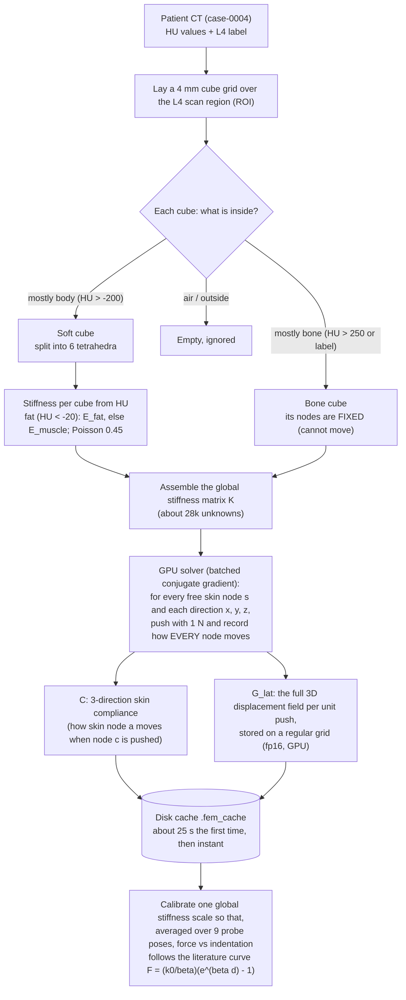
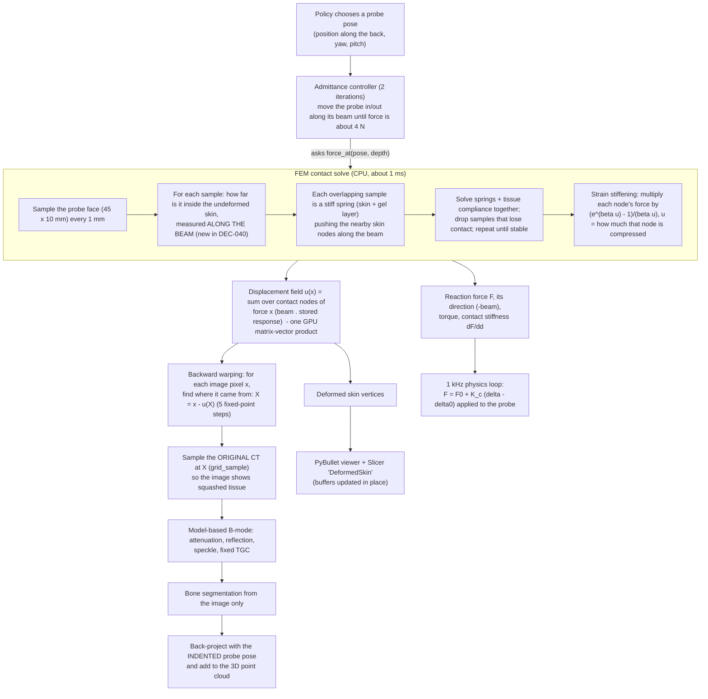
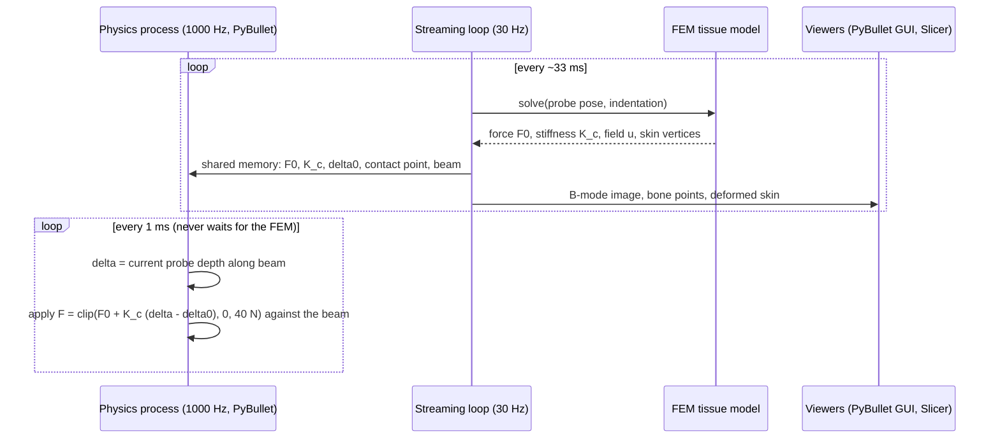
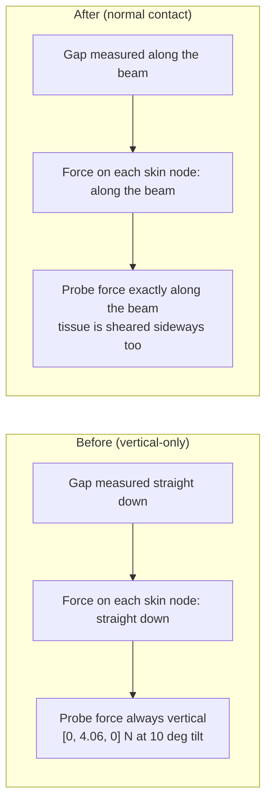

# Session report, 2026-11-05: soft-body contact fix, results explained, cleanup

Branch `audit-fixes`. Commits from this session, oldest first: `90441a2`, `498ef37`, `255bfd2`, `93b4b99`.
Every number below comes from `results/` or from a test printout, and the file is named next to it.

## 1. What I did, step by step (the log)

1. **Read the state.** I read the project memory, `git log`, the README limitations, DEC-037 to DEC-039, the FEM
   code (`fem_tissue.py`, `tet_mesh.py`) and its tests. Baseline: **97 tests passed**.
2. **Picked the limitation closest to soft-body physics, with a measurement.** With the probe tilted 10°, the FEM
   still pushed straight down: the force on the probe was `[0, 4.06, 0]` N while the beam pointed
   `[−0.17, −0.98, 0]`. A smooth (frictionless) probe face can only push along its own normal, so about 0.7 N of
   sideways load, and the sideways tissue motion it causes, were missing. Every policy tilts the probe.
3. **Grilled you (the QUIZME protocol).** You chose this fix first, a 3× precompute with the field stored in
   fp16, a full benchmark re-run without retraining, and committing the old camera edits separately. One
   correction on my side: I first said the benchmark takes "1 h+". It takes about 1 minute (49 s of wall time),
   so I asked again and you chose the full re-run.
4. **Committed the leftover camera edits** from the previous session on their own (`90441a2`).
5. **TDD, RED.** I wrote 6 new tests before touching the code:
   - **Force along the beam:** the force on the probe must be parallel to the beam. It **failed** on the old
     code, as intended.
   - **Reciprocity (Maxwell–Betti):** "push A, measure B" must equal "push B, measure A". It failed because the
     check did not exist yet.
   - **Element patch test:** a rigid motion costs no force, and a uniform stretch stores exactly the
     textbook energy. It passed: this checks the existing element code.
   - **Untilted regression:** forces for an upright probe must equal the old ones. It passed: this is the guard.
   - **Tilted shear:** a tilted probe pushes tissue sideways. It **already passed on the old model**, so it
     does not prove the fix. I kept it only as a sanity check and say so in DEC-040.
6. **GREEN** (`498ef37`). The precompute now pushes each skin node in x, y and z, not only y. The contact is
   measured and applied along the beam. All 18 FEM tests pass, and the full suite has **103 passed**.
7. **Checked the invariants.**
   - Physics loop at **1000.0 Hz**, p99 1.000 ms (`results/physics_rate_20261105_normal_contact.json`).
   - FEM solve 1.50 ms, peak VRAM 261 MB, under the 300 MB limit in the test.
8. **Re-ran the benchmarks** (`results/benchmark_latest.md`, run `20261105_120357`, and
   `results/ppo_deterministic/`). I re-ran raster and CFM a second time to prove that the benchmark is
   **deterministic**, so any change in the numbers comes from the physics change.
9. **Cleaned up** (`255bfd2`), detailed in section 5. The suite stayed green.
10. **Updated the docs** (`93b4b99`). README tables were copied from `results/` by a script, not by hand. I also
    updated FLOW, the QUIZME premises, and DEC-040 in DECISIONS (including the DEC-039 index row that was
    missing).
11. **Deleted 8 stale FEM cache files** (about 1.3 GB, gitignored). They used the old cache version, so they
    could never be loaded again.

About the commands you named: `/grill-me` was run as the repo's QUIZME protocol through interactive
questions. `/plan`, `/goal` and `/remote-control` are not skills I can invoke in this session. Remote control is
something you switch on in the Claude Code CLI yourself.

## 2. The results, in simple terms

### 2.1 What the columns mean

| Column | Plain meaning | Good is |
|---|---|---|
| Cov@3 % | How much of the back surface of L4 that ultrasound can see got a reconstructed point within 3 mm | high |
| Prec@2 % | How many reconstructed points are within 2 mm of *some* bone | high |
| Prec@2 vis % | Same, but only against the bone surface ultrasound can actually see (stricter) | high |
| Chamfer mm | Average gap between the reconstruction and the true surface | low |
| F mean / RMSE / max | Probe force, and how well it stayed at the 4 N target | 4 N / low / ≤ 20 N |
| Indent mm | How deep the probe centre sits below the undeformed skin under it (can be negative) | — |
| Path mm | How far the probe travelled | lower is cheaper |

### 2.2 Policies (72 frames each, same 3 start poses), from `results/benchmark_latest.md`

| Method | Cov@3 % | Prec@2 vis % | Chamfer mm | F RMSE N | Path mm |
|---|---|---|---|---|---|
| Raster (heuristic) | **88.1** | 97.4 | **1.05** | 0.07 | 174 |
| PPO (sampled) | 85.0 | 92.5 | 1.14 | 0.23 | 272 |
| Greedy NBV | 83.8 | 96.9 | 1.20 | 0.09 | 342 |
| CFM | 83.7 | 97.6 | 1.15 | 0.04 | 123 |
| Diffusion | 71.0 | 96.3 | 1.63 | 0.06 | 178 |
| Orbital (heuristic) | 70.1 | 94.4 | 1.61 | 0.09 | 227 |
| PPO mean action (`results/ppo_deterministic/`) | 52.6 | 92.0 | 2.45 | 0.04 | 60 |

What it means:
- **The simple raster sweep is still the best.** No learned policy beats it.
- **PPO, NBV and CFM are tied** (83.7–85.0 %). With only 3 trials, gaps of 1–2 points are noise.
- **CFM is efficient.** It covers 83.7 % with the shortest path (123 mm), because it copies a raster expert.
  Its jump from 78.4 to 83.7 % after today's fix is not learning. A cloned policy reacts to small physics
  changes (n = 3; the old std was 5.7).
- **PPO depends on its own randomness.** With the noise switched off it gets stuck (52.6 %, 60 mm of motion).
- **All methods hold the force well** (mean force about 4 N, never above 20 N). That is the admittance controller's
  doing, not the policies'.
- **Precision of 92–98 % is too good to be true.** Real spine ultrasound reaches about 0.8–0.9. The simulated
  images are too clean (no clutter or reverberation), so treat precision as optimistic.

### 2.3 Force sweep (upright probe on the midline), from `results/benchmark_latest.md`

- **FEM:** the flat probe first touches the two muscle ridges beside the spine, 9 mm before it reaches the
  midline skin, so first contact is at −9.0 mm. At 4 N it has pushed 7.1 mm past first contact, but its centre
  is still 1.9 mm *above* the midline skin: it bridges the groove.
- **The B-mode bone echo moves up as the force rises** (22.2 → 16.6 mm from 1 to 10 N), and it matches the
  depth the model predicts to within about 0.4–0.8 mm. So the deformation really reaches the image, and the test
  can catch it if it doesn't.
- **Kelvinlet is softer:** 5.2 mm at 4 N, with no ridge-bridging. At 10 N it hits its indentation limit
  (8.82 N delivered).

### 2.4 Stiffness sweep (raster, 40 poses, three tissue stiffnesses)

- **Coverage hardly changes** (76.5–77.4 %), because the force controller simply pushes deeper into soft tissue.
- **The stiffest FEM tissue tracks force worst** (RMSE 0.22 N, max 4.97 N): a fixed controller gain is
  too aggressive on stiff tissue.

### 2.5 Does accounting for deformation matter? (raster), from `results/benchmark_latest.md`

| Model / mode | Cov@3 % | Prec@2 vis % | Chamfer mm |
|---|---|---|---|
| FEM rigid (no squashing at all) | 89.0 | 97.3 | 1.04 |
| FEM aware | 88.0 | 97.2 | 1.05 |
| FEM unaware | 88.8 | 81.5 | 1.49 |
| Kelvinlet aware | 89.0 | 89.3 | 1.06 |
| Kelvinlet unaware | **23.1** | 14.9 | 3.80 |

- **"Aware" nearly matches "rigid".** The pipeline almost fully undoes the squashing.
- **With the FEM (about 1 mm of real indentation), ignoring deformation costs accuracy** (precision
  97 → 82 %, error 1.05 → 1.49 mm) **but not coverage**.
- **With the softer Kelvinlet (about 6 mm), ignoring it is a disaster** (23 % coverage).
- **So "deformation awareness matters" scales with how much the tissue moves.** It is not a blanket claim.

### 2.6 Physics rate

- 1000.0 Hz, p99 period 1.000 ms, 17 late ticks out of 20,015, streaming at 29.9 Hz
  (`results/physics_rate_20261105_normal_contact.json`).
- The real-time loop is unaffected by today's heavier FEM.

### 2.7 Overall

**What works:** the physics and soft-body pipeline is consistent and measurable, and the deformation shows up
correctly in the images.

**What is not shown yet:**
- that learning beats a simple sweep;
- that anything generalises beyond one patient;
- that the perception would hold up on realistic, noisy images.

## 3. How soft-body deformation is implemented

### 3.1 The idea in one paragraph

When the probe presses on the back, the skin and the fat and muscle under it get squashed, and the bone does
not move. We need three things from that: **how hard the tissue pushes back** (so the robot can hold 4 N),
**where every bit of tissue has moved to** (so the ultrasound image shows squashed tissue), and **the new
shape of the skin** (so PyBullet and Slicer can draw the dent). A full finite-element (FEM) simulation gives
all three, but solving it from scratch for every frame is too slow. So we solve the expensive part **once**,
ahead of time, and every frame only does a small, fast calculation.

### 3.2 One-off setup: build the mesh and precompute the responses

Why this works: the material is **linear**. The response to "1 N here plus 2 N there" is exactly the response
to the first push plus twice the response to the second. So if we know the response to a 1 N push at every
skin node, in every direction, **any** probe contact is just a weighted sum of these stored responses.

### 3.3 Every frame: from probe pose to force, deformed tissue and image

### 3.4 How the three clocks share the work

The physics loop never calls the FEM: one solve takes about 1.5 ms, which would not fit in a 1 ms tick.
Between FEM updates it uses a straight-line guess of the force (the first-order extrapolation above).

### 3.5 What changed today (DEC-040): which way the tissue pushes

Before today, every contact force was assumed to point straight down into the body (−Y in frame P), and
"how deep is the probe" was measured straight down. That is correct when the probe is upright. But the
policies tilt the probe by up to ±10° (pitch) and ±15° (yaw), and a smooth (frictionless) flat probe face
can only push **perpendicular to its own surface**, that is, along its beam. A 10° tilted probe at 4 N
therefore pushes sideways with about 0.7 N, and the old model left that out entirely: the reported force
vector was always `[0, 4.06, 0]`.

To push along any direction, the precompute now stores the response to pushes in x, y **and** z (3× the
work: about 25 s once instead of 6 s, then cached). The stored field is kept in half precision, so the GPU
memory is 233 MB instead of 3 × 156 MB. For an upright probe the new model gives **exactly** the old
forces (a test checks this to 0.2 %), so nothing that worked before changed.

### 3.6 What is still approximate (plain list)

- **Linear, small strain.** The tissue is treated as a linear spring network. Real fat and muscle stiffen as
  they are squashed; we copy that onto the *force* with the exponential factor, but the *shape* of the
  deformation stays linear.
- **No friction.** The probe can only push straight along its beam. A real probe with gel has a little
  friction, which would drag the skin sideways when the probe slides.
- **Only the L4 region deforms.** Outside the box around L4 the tissue does not move.
- **One patient.** The mesh, stiffness and calibration all come from one CT.

## 4. Cleanup done (commit `255bfd2`)

- **Removed code nothing called:**
  - `generate_multi_patient_dataset`: its "varied anatomy" settings were computed and then never applied, so the
    name was misleading;
  - an unused NIfTI loader;
  - two `sample_parameter_ranges`;
  - `reset_cache`, `get_contact_indentation`, `lattice_flat_index`, `patient_to_ras_matrix`,
    `extract_reliable_bone_points`, `get_skin_surface_y`;
  - `BoneSegmenter.segment`, which had a switch to the ground-truth labels.
- **Removed parameters that were accepted but silently ignored:** in the env, the slice extractor, the point
  accumulator and the segmenter.
- **Made a safety rule structural:** the confidence map no longer accepts the simulator's privileged energy
  map. Passing it now raises an error, and a test checks this.
- **Removed stale files:** a stray comparison PNG in the repo root, a Kinova YAML config that nothing loaded,
  and a duplicate template `.gitignore`.
- **Marked old documents as historical:** the 2025 design doc, the Slicer MuJoCo plan and the mid-term
  presentation folder now say they are historical, so nobody quotes their numbers.
- **Left for you to decide:** about 85 MB of literature PDFs tracked in git (keep them, move them out, or put
  them in LFS).

## 5. What is next (remaining limitations, most soft-body-relevant first)

1. **Friction (stick/slip) at the probe.** Normal contact is now in place, which friction needs. Friction would
   let a sliding probe drag the skin.
2. **Nonlinear deformation shape.** Stiffening is applied to the force only. A co-rotational or hyperelastic
   model would change the shape too, but it breaks the "precompute once" trick.
3. **Retrain PPO, CFM and Diffusion on the new contact.** Their checkpoints predate DEC-040.
4. **A harder ultrasound simulator** (clutter, reverberation, soft-tissue echoes), so precision stops being
   unrealistically high.
5. **More patients**, so generalisation can be tested.

Each of these needs a short grilling round first (QUIZME).
