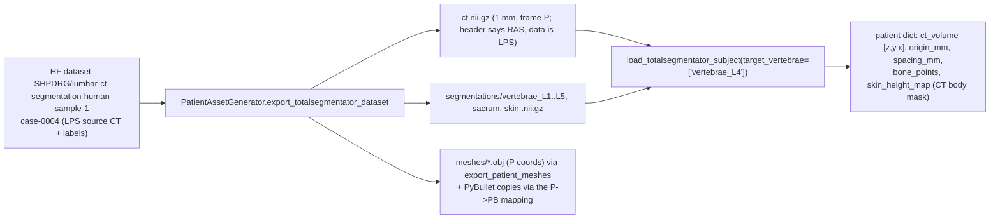
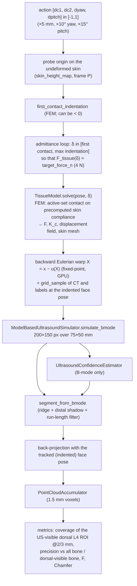
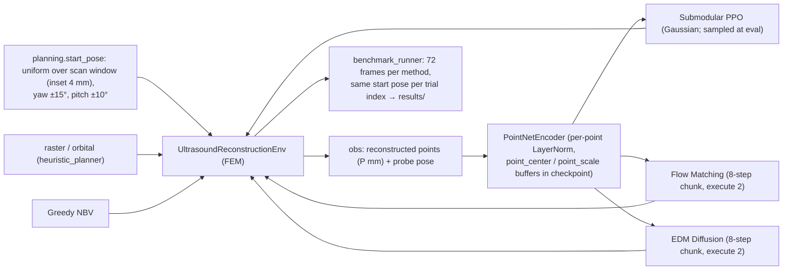

# FLOW.md: Execution Flows, Data Routes & Frames

This file maps the entry points, runtime flows, data routes and coordinate frames of the MTP codebase. Read it
before you change an entry point or a data route. All paths are relative to the repository root. Use
`./.venv/bin/python` for every command.

---

## 1. Entry points

| Purpose | Entry point | Typical command |
| :--- | :--- | :--- |
| Unified server: 1 kHz physics + 30 Hz US/streaming + Slicer | [`surgical_physics_bridge/src/unified_server.py`](surgical_physics_bridge/src/unified_server.py) | `./.venv/bin/python surgical_physics_bridge/src/unified_server.py --mode raster_l4 --fps 30 [--gui]` |
| Physics-rate measurement (headless) | same | `./.venv/bin/python surgical_physics_bridge/src/unified_server.py --benchmark-seconds 20` |
| 3D Slicer bridge | [`Slicer/slicer_surgical_physics_bridge.py`](Slicer/slicer_surgical_physics_bridge.py) | `Slicer --python-script Slicer/slicer_surgical_physics_bridge.py` |
| Server + Slicer launcher | [`scripts/launch_dual_pybullet_slicer.sh`](scripts/launch_dual_pybullet_slicer.sh) | `bash scripts/launch_dual_pybullet_slicer.sh --mode raster_l4` |
| 6-policy + soft-body benchmark | [`ReconstructionPipeline/evaluation/benchmark_runner.py`](ReconstructionPipeline/evaluation/benchmark_runner.py) | `./.venv/bin/python ReconstructionPipeline/evaluation/benchmark_runner.py --patient-dir data/sample_totalsegmentator_patient --num-trials 3 --policies raster,orbital,nbv,ppo,cfm,diffusion --soft-body` |
| Train Submodular PPO | [`ReconstructionPipeline/planning/train_submodular_ppo.py`](ReconstructionPipeline/planning/train_submodular_ppo.py) | `./.venv/bin/python ReconstructionPipeline/planning/train_submodular_ppo.py [--max-minutes 30] [--dry-run]` |
| Train CFM + EDM diffusion (BC) | [`ReconstructionPipeline/planning/train_diffusion_policy.py`](ReconstructionPipeline/planning/train_diffusion_policy.py) | `./.venv/bin/python ReconstructionPipeline/planning/train_diffusion_policy.py --num-demo-episodes 200` |
| Patient assets (download + resample + meshes) | [`ReconstructionPipeline/data/prepare_patient_assets.py`](ReconstructionPipeline/data/prepare_patient_assets.py) | `./.venv/bin/python -m ReconstructionPipeline.data.prepare_patient_assets --export-totalseg data/sample_totalsegmentator_patient` |
| FEM soft-body demo video / dataset | [`ReconstructionPipeline/scripts/record_soft_body_demonstrations.py`](ReconstructionPipeline/scripts/record_soft_body_demonstrations.py) | `./.venv/bin/python -m ReconstructionPipeline.scripts.record_soft_body_demonstrations --video` |
| Tests | [`ReconstructionPipeline/tests/`](ReconstructionPipeline/tests) | `./.venv/bin/python -m pytest ReconstructionPipeline/tests/ -q` |
| Remote GPU automation | [`scripts/run_remote_totalsegmentator.sh`](scripts/run_remote_totalsegmentator.sh) | `bash scripts/run_remote_totalsegmentator.sh --mode all --dataset-dir <subject>` (only inside `*/workspace/rishang/*`) |

Server `--mode` choices are `orbital_l4` (default), `raster_l4`, `orbital`, `raster`, `nbv`, `diffusion`, `cfm` and
`interactive` (hold pose). Other server flags: `--port` (18944), `--urdf` (default Franka Panda), `--patient-dir`,
`--gui`, `--fps`, `--physics-mode {process,thread}`, `--physics-hz`, `--tissue-backend {fem,kelvinlet}`,
`--benchmark-seconds` and `--no-benchmark-client`.

---

## 2. Flow A: patient asset preparation



`ct.nii.gz` and the segmentations are gitignored. The OBJ meshes are tracked. The server writes
`meshes/patient_fem_skin.obj` at startup.

---

## 3. Flow B: unified server runtime

```mermaid
sequenceDiagram
    autonumber
    participant Phys as Physics process (1 kHz, PyBullet DIRECT)
    participant Srv as Streaming loop (unified_server, --fps)
    participant Env as UltrasoundReconstructionEnv + FEM
    participant View as Viewer process (--gui only)
    participant Sl as 3D Slicer bridge

    loop every 1 ms
        Phys->>Phys: drain commands (latest target wins), IK + motors
        Phys->>Phys: δ = probe-face indentation along beam; F = F0 + K_c(δ − δ0), clip [0, TISSUE_FORCE_MAX_N]
        Phys->>Phys: stepSimulation; write contact snapshot, view snapshot, rate ring buffers
    end

    loop every 1/fps s (30 Hz)
        Srv->>Env: step(action from trajectory / NBV / CFM / diffusion)
        Env-->>Srv: B-mode, recon points, force, tissue state (F0, K_c, δ0, in_contact)
        Srv->>Phys: ("target", {contact_pb, beam_pb, lateral_pb, tissue, force_n, hud})
        Srv->>View: ("target", ...), ("skin", deformed skin in PB)
        Srv->>Sl: UltrasoundProbe, US_Image, ReconstructedBone, DeformedSkin, Telemetry
    end

    opt incoming (StringMessage JSON)
        Sl-->>Srv: CMD {"reset"} / {"mode"} / {"roi_target": [R,A,S]}
        Sl-->>Srv: VirtualFixture {"vertices", "indices", "policy": "keep_out"}
        Srv->>Phys: ("fixture", data)
    end
```

- **Process model.** `--physics-mode process` is the default. The physics loop is spawned in its own process and
  shares `PhysicsChannels` with the streaming side: a `commands` queue, a lock-protected `contact` snapshot, a
  `view` snapshot, a `viewer` queue and `RawArray` ring buffers for `PhysicsRateMonitor`. `thread` mode exists
  for comparison. `inline` is used by the tests.
- **Streaming side.** It never imports or calls PyBullet. `test_server.py::test_streaming_side_never_imports_pybullet`
  checks this.
- **Probe–torso contact.** The torso is visual-only, so there is no rigid probe–torso collision. The probe force
  comes from the tissue model. PyBullet still provides robot dynamics, the table and virtual keep-out fixtures.
- **ROI targets.** `roi_target` is converted RAS → P with `ras_to_patient_points` and clipped to the env scan
  window. The current Slicer bridge does not send `CMD` or `VirtualFixture`; another OpenIGTLink client must send
  them.

### OpenIGTLink messages (server → Slicer; all patient data in frame P, mm)

| Device | Type | Payload |
| :--- | :--- | :--- |
| `UltrasoundProbe` | TransformMessage | 4×4 T_P←probe of the indented probe face / image plane, +Y = beam |
| `US_Image` | ImageMessage | uint8 (H, W, 1) B-mode, row 0 = probe face |
| `ReconstructedBone` | ImageMessage | float32 (1, N, 3) accumulated bone points (array transport; pyigtl 0.3.4 has no NDARRAY) |
| `DeformedSkin` | ImageMessage | float32 (1, N, 3): all N skin-patch vertices in `patient_fem_skin.obj` order. The bridge also accepts (1, K, 4) `[index, dx, dy, dz]` rows. |
| `Telemetry` | StringMessage | JSON: normal force, indentation, in_contact, contact stiffness, coupling, physics-rate stats, rigid contacts |

---

## 4. Flow C: one environment step (simulation and perception)



**Deformation modes** (ablation only):

- `aware` (default): deformed images, back-projected with the tracked face pose.
- `unaware`: deformed images, back-projected with the nominal undeformed-skin pose.
- `rigid`: no deformation; the probe sits on the skin.

`segment_from_label_map` is an evaluation oracle only. It must never feed the reconstruction. The simulator
outputs `energy`, `effective_energy` and `bone_mask` are privileged and must not reach perception.

---

## 5. Flow D: planning, training and benchmark



**PPO training** (`train_submodular_ppo.py`):

- **Reward.** The default (`--reward coverage`) is 100 × the gain in Cov@3 plus the env's path, rotation and force
  penalties.
- **Point cloud.** The cloud is subsampled once per step and stored, so the rollout and the update see the same cloud.
- **Truncation.** Time-limit truncation bootstraps with γV(s_{T+1}).
- **Episodes.** 72 steps each. `--max-minutes` time-boxes training.

**BC training** (`train_diffusion_policy.py`):

- **Expert.** A randomised elevational raster: random start pose, raster width, line count, frames per line and extent.
- **Validation.** Episodes are split train/val (`--val-frac 0.15`) before chunking. The checkpoint with the best
  validation loss (fixed noise seed) is kept.
- **Datasets.** `--save-demos` / `--demo-dataset` datasets must contain the logged clouds.
- **Outputs.** It trains both CFM (`checkpoints/flow_matching.pt`) and EDM (`checkpoints/diffusion_policy.pt`).

**Benchmark** (`benchmark_runner.py`):

- **Missing checkpoints.** A missing checkpoint for a requested learned policy is an error. Use
  `--heuristics-only` or `--policies raster,orbital,nbv` without checkpoints.
- **Default patient.** Without `--patient-dir` the runner uses the synthetic phantom.
- **Outputs.** It writes `results/benchmark_<ts>.json` and `results/benchmark_latest.md`.

---

## 6. Flow E: Slicer bridge

1. The bridge connects with `pyigtl` to `localhost:18944` and retries until the server is up.
2. It creates one `vtkMRMLLinearTransformNode` named `PatientToRAS` that holds `P_TO_RAS = diag(−1, −1, 1)`, and
   parents every patient node under it.
3. It loads the meshes with `obj_io.read_obj`, which preserves vertex order. It does not use
   `slicer.util.loadModel`, which would treat the OBJ as LPS and flip it a second time.
4. `DeformedSkin` handling: one float32 array is bound to the skin-patch `vtkPoints` once
   (`numpy_to_vtk(deep=False)`). Each frame does `arr[:] = base; arr[idx] += disp` followed by `Modified()`. No
   per-frame VTK allocation takes place.
5. `US_Image` is shown in the Red view, and `Telemetry` is logged every 5 s. The image node has an explicit
   display node with a fixed grey W/L of 255/127.5 (the frames are already scaled to 0..255 uint8). Its spacing
   is 50/149 mm lateral by 75/199 mm axial, matching `IMAGE_SIZE`/`PHYSICAL_SIZE_MM` in `env_reconstruction.py`.
   Auto W/L must stay off: it would be computed from the all-zero placeholder (W/L = 0/0) and threshold every
   frame to binary noise.

This flow is not covered by automated tests inside Slicer. It was checked by hand on 2026-11-05 in
Slicer 5.12.4 (recipe 10).

---

## 7. Coordinate frames

| Frame | Convention | Units | Conversion |
| :--- | :--- | :--- | :--- |
| **P** (patient / simulation) | CT array frame, **LPS**: +X left, +Y posterior (toward dorsal skin), +Z superior. Volumes indexed [z, y, x], point = origin + index · spacing. | mm | – |
| **RAS** (3D Slicer world) | Right, Anterior, Superior | mm | `p_RAS = P_TO_RAS · p_P`, `P_TO_RAS = diag(−1, −1, +1)` (det +1), applied once by the `PatientToRAS` transform node |
| **PB** (PyBullet world) | Z-up | m | `pb = (0.55 + x, z, 0.42 + (y − 55)) · 1e-3`, i.e. `P_TO_PB_ROT` (permutation, det −1) and `P_TO_PB_OFFSET_M = (0.55, 0, 0.365)`. Orientations go through `probe_axes_to_pybullet_quaternion` (always a proper rotation). |
| **U** (probe) | origin at the undeformed skin contact under the probe centre; columns e_x = lateral array axis, b = +Y_probe = beam (into the body), e_z = elevation | mm | `T_P←U`. The face/image plane is at origin + δ·b. |

Use the helpers in `surgical_physics_bridge/src/coordinates.py`: `patient_to_ras_points`, `ras_to_patient_points`,
`patient_pose_to_ras`, `patient_to_pybullet_points`, `pybullet_to_patient_points`, `ras_to_pybullet_points`, `probe_axes_to_pybullet_quaternion`. `ReconstructionPipeline/tests/test_coordinates.py`
tests them, including the check that the P→PB mapping matches the exported PyBullet meshes.

---

## 8. Verification recipes

```bash
# 1. Full test suite (97 tests)
./.venv/bin/python -m pytest ReconstructionPipeline/tests/ -q

# 2. FEM timings and calibration printout
./.venv/bin/python -m pytest ReconstructionPipeline/tests/test_fem_tissue.py -q -s

# 3. Physics rate with streaming active (compare with results/physics_rate_20261104_idle.json)
./.venv/bin/python surgical_physics_bridge/src/unified_server.py --benchmark-seconds 20

# 4. Heuristic benchmark (no checkpoints)
./.venv/bin/python ReconstructionPipeline/evaluation/benchmark_runner.py \
  --patient-dir data/sample_totalsegmentator_patient --num-trials 3 --heuristics-only

# 5. Full benchmark (regenerates results/benchmark_latest.md)
./.venv/bin/python ReconstructionPipeline/evaluation/benchmark_runner.py \
  --patient-dir data/sample_totalsegmentator_patient --num-trials 3 \
  --policies raster,orbital,nbv,ppo,cfm,diffusion --soft-body

# 6. PPO smoke test / training
./.venv/bin/python ReconstructionPipeline/planning/train_submodular_ppo.py --dry-run
./.venv/bin/python ReconstructionPipeline/planning/train_submodular_ppo.py --max-minutes 30 --log-csv ppo.csv

# 7. CFM + diffusion behaviour cloning
./.venv/bin/python ReconstructionPipeline/planning/train_diffusion_policy.py --num-demo-episodes 200 --report-json bc_report.json

# 8. Live server + Slicer
./.venv/bin/python surgical_physics_bridge/src/unified_server.py --mode raster_l4 --fps 30 --gui
Slicer --python-script Slicer/slicer_surgical_physics_bridge.py
#    or: bash scripts/launch_dual_pybullet_slicer.sh --mode raster_l4

# 10. Screenshots on Wayland (external capture tools cannot see these windows)
#     PyBullet: the GUI viewer process renders its own debug camera to PNG every N s (viewer process only).
MTP_VIEWER_SNAPSHOT_DIR=.agents/shots MTP_VIEWER_SNAPSHOT_S=5 \
  ./.venv/bin/python surgical_physics_bridge/src/unified_server.py --mode raster_l4 --fps 30 --gui
#     Slicer: in its Python console, slicer.app.layoutManager().sliceWidget("Red").sliceView().grab().save("red.png")

# 9. Remote GPU host (must be inside */workspace/rishang/*)
rsync -avz --exclude '.venv' --exclude '__pycache__' --exclude '.agents' ./ user@172.18.17.35:/home/user/workspace/rishang/MTP/
ssh user@172.18.17.35 'cd /home/user/workspace/rishang/MTP && bash scripts/run_remote_totalsegmentator.sh --mode all'
```
