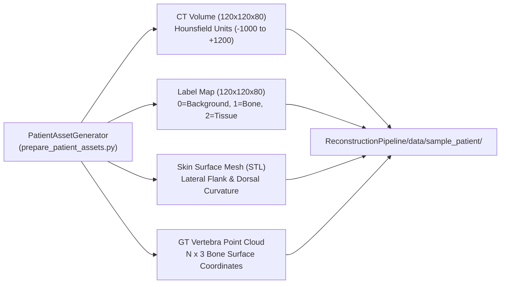
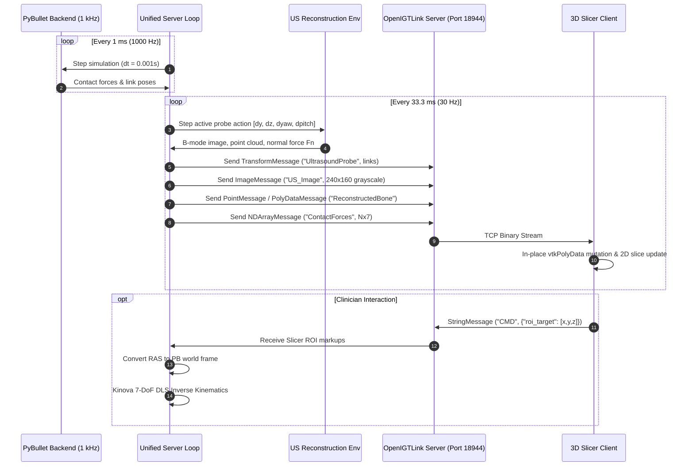
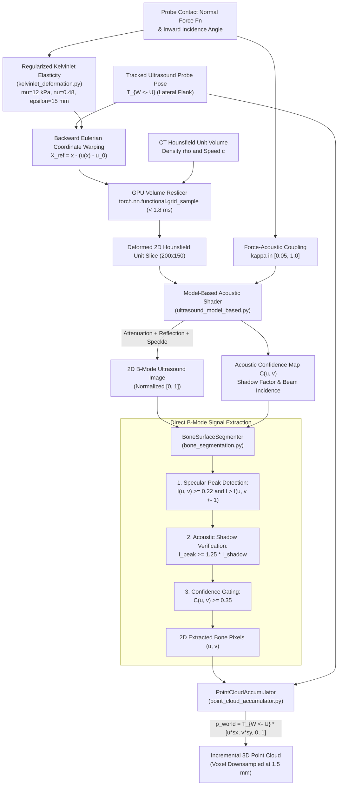
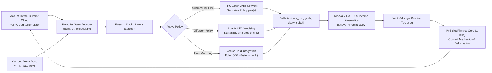
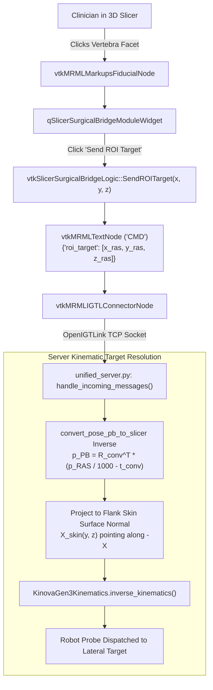

# FLOW.md - Codebase Execution Flow & Architecture Guide

A comprehensive architectural map detailing all entry points, execution flows, communication protocols, and runtime dependencies for the **Surgical Physics Bridge & Autonomous Robotic Ultrasound (MTP)** codebase.

---

## 1. Directory of Primary Entry Points

| Purpose / Task | Entry Point Script | Standard Invocation Command |
| :--- | :--- | :--- |
| **Unified Server (Physics + US + Slicer)** | [`surgical_physics_bridge/src/unified_server.py`](file:///home/rishang/Desktop/Insti_Stuff/MTP/surgical_physics_bridge/src/unified_server.py) | `./.venv/bin/python surgical_physics_bridge/src/unified_server.py --port 18944 --mode orbital --fps 30.0` |
| **Standalone Physics Server (PyBullet)** | [`surgical_physics_bridge/src/server.py`](file:///home/rishang/Desktop/Insti_Stuff/MTP/surgical_physics_bridge/src/server.py) | `./.venv/bin/python surgical_physics_bridge/src/server.py --port 18944 --gui` |
| **6-Policy Benchmark Runner** | [`ReconstructionPipeline/evaluation/benchmark_runner.py`](file:///home/rishang/Desktop/Insti_Stuff/MTP/ReconstructionPipeline/evaluation/benchmark_runner.py) | `./.venv/bin/python ReconstructionPipeline/evaluation/benchmark_runner.py --num-trials 3` |
| **Patient Asset Generation (CT/Spine)** | [`ReconstructionPipeline/data/prepare_patient_assets.py`](file:///home/rishang/Desktop/Insti_Stuff/MTP/ReconstructionPipeline/data/prepare_patient_assets.py) | `./.venv/bin/python -m ReconstructionPipeline.data.prepare_patient_assets` |
| **Train Submodular PPO (Active DRL)** | [`ReconstructionPipeline/planning/train_submodular_ppo.py`](file:///home/rishang/Desktop/Insti_Stuff/MTP/ReconstructionPipeline/planning/train_submodular_ppo.py) | `./.venv/bin/python ReconstructionPipeline/planning/train_submodular_ppo.py --num-updates 20` |
| **Train 3D Diffusion Policy (DP3/EDM)** | [`ReconstructionPipeline/planning/train_diffusion_policy.py`](file:///home/rishang/Desktop/Insti_Stuff/MTP/ReconstructionPipeline/planning/train_diffusion_policy.py) | `./.venv/bin/python ReconstructionPipeline/planning/train_diffusion_policy.py --epochs 50 --batch-size 32` |
| **Run Unit & Integration Test Suite** | [`ReconstructionPipeline/tests/`](file:///home/rishang/Desktop/Insti_Stuff/MTP/ReconstructionPipeline/tests) | `./.venv/bin/python -m pytest ReconstructionPipeline/tests/ -v` |
| **Remote TotalSegmentator Automation (SSH)** | [`scripts/run_remote_totalsegmentator.sh`](file:///home/rishang/Desktop/Insti_Stuff/MTP/scripts/run_remote_totalsegmentator.sh) | `bash scripts/run_remote_totalsegmentator.sh --dataset-dir /data/s0010 --mode all` |
| **3D Slicer Loadable C++ Module** | [`SlicerSurgicalBridge/`](file:///home/rishang/Desktop/Insti_Stuff/MTP/SlicerSurgicalBridge) | Built via CMake against Slicer SDK; loaded as Qt extension |

---

## 2. End-to-End System Execution Flows

### Flow A: Offline Patient Asset Generation
Generates synthetic or TotalSegmentator clinical CT volumes, anatomical label maps, dorsal/flank skin meshes, and ground-truth bone point clouds.



---

### Flow B: Live Physics Simulation & OpenIGTLink Streaming
The primary runtime service loop executed by [`unified_server.py`](file:///home/rishang/Desktop/Insti_Stuff/MTP/surgical_physics_bridge/src/unified_server.py). Decouples 1000 Hz PyBullet contact dynamics from 30–60 Hz Slicer OpenIGTLink publishing.



---

### Flow C: Ultrasound Simulation & Pure B-Mode Surface Extraction
Extracts 3D bone point clouds **strictly from 2D ultrasound signals** (zero ground-truth CT label leakage), featuring real-time **GPU soft-tissue deformation** via Regularized Kelvinlets.



---

### Flow D: Active View Planning & Closed-Loop Control Loop
Reinforcement Learning (Submodular PPO) and Generative Policies (Continuous Flow Matching, 3D Diffusion Policy).



---

### Flow E: Clinician-in-the-Loop Slicer Fiducial Target Workflow
Enables interactive point-and-click target selection in 3D Slicer.



---

## 3. Coordinate System Conversions & Invariants

| Space / Frame | Origin & Axis Convention | Units | Conversion to/from |
| :--- | :--- | :--- | :--- |
| **PyBullet World** | Origin at surgical table base. **X-forward, Y-left, Z-up**. | **Meters** | Base reference frame for all rigid/soft dynamics. |
| **3D Slicer RAS** | Origin at CT scan center. **Right (+X), Anterior (+Y), Superior (+Z)**. | **Millimeters** | $\mathbf{p}_{\text{RAS}} = \mathbf{T}_{\text{conv}} \cdot (\mathbf{p}_{\text{PB}} \times 1000)$ |
| **Ultrasound Probe $\{U\}$** | Origin at center of transducer face. **Beam along $+Y_{\text{probe}}$**. | **Millimeters** | Transformed into PyBullet world via $\mathbf{T}_{W \leftarrow U}$. |
| **Lateral Flank Geometry** | Patient lying horizontally along Z. Flank skin at $X \approx +48\text{ mm}$, beam directed along **$-X$** toward spine. | **Millimeters** | Orthonormal matrix $\mathbf{R}_{W \leftarrow U}$ with columns $[[0,0,1]^\top, [-1,0,0]^\top, [0,-1,0]^\top]$. |

---

## 4. Standard Developer Verification Recipes

### 1. Full Unit Test Suite (21 Tests)
```bash
./.venv/bin/python -m pytest ReconstructionPipeline/tests/ -v
```

### 2. Run 6-Policy Benchmark (3 Trials per Method)
```bash
./.venv/bin/python ReconstructionPipeline/evaluation/benchmark_runner.py --num-trials 3
```

### 3. Launch Unified Server (Streaming to 3D Slicer)
```bash
./.venv/bin/python surgical_physics_bridge/src/unified_server.py --port 18944 --mode orbital --fps 30.0
```

### 4. Train 3D Diffusion Policy
```bash
./.venv/bin/python ReconstructionPipeline/planning/train_diffusion_policy.py --epochs 50 --batch-size 32
```

### 5. Train Submodular PPO
```bash
./.venv/bin/python ReconstructionPipeline/planning/train_submodular_ppo.py --num-updates 20 --num-steps 128
```
