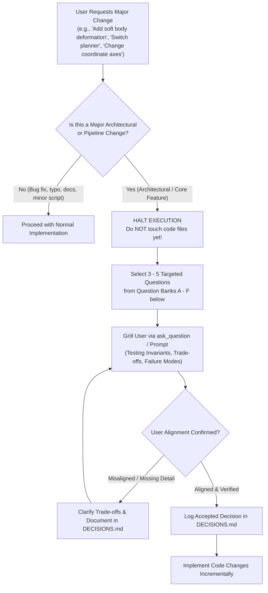

# QUIZME.md - Pre-Implementation Architectural Grilling Protocol

> **CRITICAL OPERATING DIRECTIVE FOR AGENTS**:
> Whenever the user requests a **major architectural change**, **new simulation backend**, **new planning policy**, **coordinate frame modification**, or **refactoring of core pipelines** in this repository:
> 
> 1. **DO NOT IMMEDIATELY START WRITING OR EDITING CODE.**
> 2. **HALT AND EXECUTE THE GRILLING PROTOCOL.**
> 3. Formulate **3 to 5 targeted, high-signal technical questions** (using the `ask_question` tool or interactive prompt) directly derived from the question banks below.
> 4. Verify that the user (and agent) are fully aligned on invariants, physical trade-offs, coordinate transformations, and failure modes before any implementation begins.

---

## 1. The Grilling Protocol Workflow

---

## 2. Category Question Banks

### Category A: Physics Core & Multi-Rate Decoupling
*Questions to ask if modifying `PyBulletBackend`, contact mechanics, or physics solvers:*
1. **Clock Decoupling**: *"PyBullet runs at 1000 Hz while Slicer renders at 30–60 FPS. How does your proposed change ensure the 1 ms physics integration timestep ($dt = 0.001\text{ s}$) is never blocked by Slicer UI rendering latency or network socket stalls?"*
2. **Force-Coupling Window**: *"Our clinical safety acoustic window requires normal contact force $F_N \in [2.0, 8.0]\text{ N}$. If your new controller commands an abrupt penetration velocity, how will you prevent numerical force spikes or penetration instability in PyBullet's penalty solver?"*
3. **Collision Geometry**: *"Are you using convex collision hulls or raw triangle meshes? How will PyBullet's GJK/EPA solver handle potential concave mesh self-intersections during deformation?"*

---

### Category B: Coordinate Transformations & Spatial Consistency
*Questions to ask if modifying kinematics, probe poses, or Slicer coordinate bridges:*
1. **Frame Conventions**: *"PyBullet operates in metric Z-up (meters); 3D Slicer operates in millimeter RAS (Right-Anterior-Superior). Does your proposed vector live in PyBullet world, probe frame $\{U\}$, or Slicer RAS? What is the explicit transformation matrix?"*
2. **Orthonormal Basis**: *"In the lateral flank approach, the probe face points along $-X$ into the patient flank. What are the column vectors of your rotation matrix $\mathbf{R}_{W \leftarrow U} \in SO(3)$, and does $\det(\mathbf{R}) = +1.0$ (right-handed)?"*
3. **Point Cloud Registration**: *"When back-projecting 2D pixels $(u, v)$ to 3D world coordinates $\mathbf{p}_{\text{world}}$, are you accounting for pixel spacing ($0.5\text{ mm/px}$) and probe center offset before applying $\mathbf{T}_{W \leftarrow U}$?"*

---

### Category C: Ultrasound Acoustics & Perception Pipeline
*Questions to ask if modifying ultrasound shaders, segmentation, or CT reslicing:*
1. **Decoupling from Ground Truth**: *"Does your new feature rely on ground-truth CT segmentation label maps (`segment_from_label_map`) or pure B-mode ultrasound signal processing (`segment_from_bmode`)? How are you preventing ground-truth label leakage?"*
2. **Acoustic Shadow Verification**: *"A bright echo can come from muscular fascia or bone cortex. How does your segmentation logic confirm the presence of a distal acoustic shadow ($I_{\text{peak}} \ge 1.25 \cdot \bar{I}_{\text{shadow}}$) to reject false fascia reflections?"*
3. **GPU Slicing Throughput**: *"Our GPU trilinear reslicer (`torch.nn.functional.grid_sample`) executes in $< 1.8\text{ ms}$. Does your proposed volume resampling maintain sub-2ms latency on GPU without allocating new memory buffers?"*

---

### Category D: Active Planning & Reinforcement Learning
*Questions to ask if modifying PPO, Diffusion Policy, Flow Matching, or reward functions:*
1. **The Imitation Learning Ceiling**: *"If training a Diffusion Policy or Continuous Flow Matching model, what is the bone coverage percentage of your demonstration dataset? If the expert only achieves $10\%$, how will the cloned policy ever achieve $75\%$?"*
2. **Submodular Diminishing Returns**: *"Why is active ultrasound scanning formulated as a monotone submodular set function rather than standard Markovian reward? How does your reward function penalize redundant re-scanning of already observed bone voxels?"*
3. **Action Chunking vs. 1-Step Lookahead**: *"Why does Greedy Next-Best-View get trapped in flat dorsal plateaus while Continuous Flow Matching achieves $11.2\%$ coverage? How does multi-step action chunking ($H = 8$) resolve local minima?"*
4. **Episode Horizon**: *"A 60-step episode limits probe travel to $\le 300\text{ mm}$. If the goal is full L4-L5 vertebra coverage, why must the horizon be extended to 180–250 steps?"*

---

### Category E: 3D Slicer & OpenIGTLink Integration
*Questions to ask if modifying C++ module code or network message formats:*
1. **In-Place VTK Mutation**: *"Why do we mutate `vtkPolyData` in-place using `SetComponent()` instead of creating a new `vtkMRMLModelNode` on each received frame? What happens to Slicer's VTK rendering pipeline and memory heap if you re-instantiate nodes at 30 FPS?"*
2. **Device Name Routing**: *"Slicer's `OpenIGTLinkIF` dispatches packets strictly by `device_name`. Does your new message use an existing registered device name (`US_Image`, `ReconstructedBone`, `ContactForces`, `CMD`, `VirtualFixture`) or require modifying the C++ listener?"*
3. **Coordinate Unit Mismatch**: *"Contact force vectors are sent as an $N \times 7$ array. If positions are in meters and Slicer displays in millimeters, what scaling factor is applied in C++ to make the `vtkLine` arrow glyphs visible?"*

---

### Category F: Soft Body & Deformable Mechanics
*Questions to ask if modifying tissue deformation, Kelvinlets, Warp FEM, or SOFA:*
1. **Eulerian vs. Lagrangian Reslicing**: *"When tissue deforms under probe pressure, do you plan to re-mesh the tetrahedral volume on every timestep ($> 50\text{ ms}$), or use backward Eulerian coordinate warping $\mathbf{X}_{\text{ref}} = \mathbf{x} - \mathbf{u}(\mathbf{x})$ via GPU `grid_sample` ($< 1.5\text{ ms}$)?"*
2. **Deformation Engine Trade-off**: *"Why choose Regularized Kelvinlets for fast RL training ($< 0.3\text{ ms}$, differentiable) over heavy FEM solvers like SOFA ($15-35\text{ ms}$, CPU-bound)? When is full hyperelastic Neo-Hookean FEM actually needed?"*
3. **Acoustic Wave Changes**: *"As probe pressure increases from 2 N to 6 N, subcutaneous fat compresses. How does your acoustic shader reflect this physical layer thinning in the resulting B-mode ultrasound image?"*

---

## 3. Checklist Required to Pass the Grill

Before writing a single line of implementation code, the agent and user must agree on:

- [ ] **Core Invariants Preserved**: Python `./.venv/bin/python`, 1000 Hz physics decoupled from 30 FPS display, in-place VTK memory mutation.
- [ ] **Frame Math Validated**: Spatial transformations between PyBullet world (meters) and Slicer RAS (mm) are mathematically proven.
- [ ] **Acoustic Physics Grounded**: Ultrasound extraction remains purely signal-based without ground-truth label leakage.
- [ ] **Performance Budget Met**: Ultrasound generation $< 2\text{ ms}$, physics step $< 1\text{ ms}$, RL inference $< 5\text{ ms}$.
- [ ] **DECISIONS.md Updated**: The decision, context, alternatives, and rationale are documented in `DECISIONS.md`.
