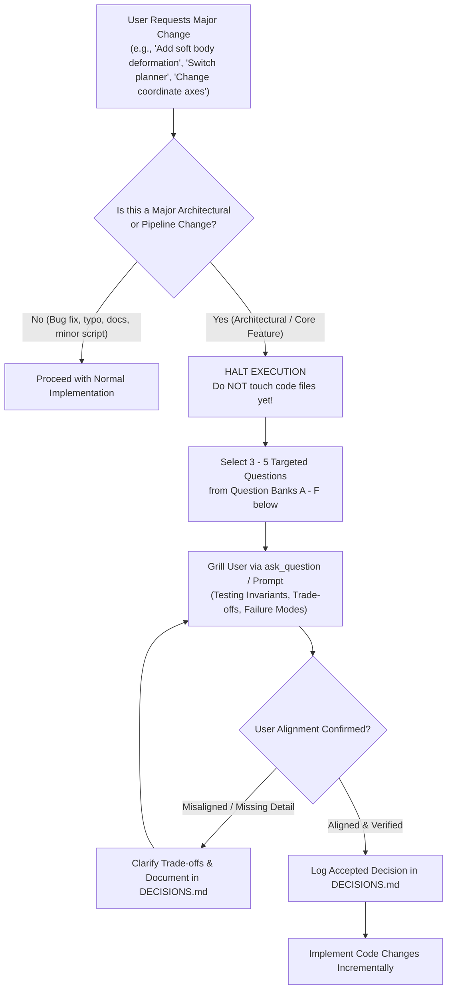

# QUIZME.md - Pre-Implementation Architectural Grilling Protocol

> **CRITICAL OPERATING DIRECTIVE FOR AGENTS**:
> Whenever the user requests a **major architectural change**, **new simulation backend**, **new planning policy**, **coordinate frame modification**, or **refactoring of core pipelines** in this repository:
> 
> 1. **DO NOT IMMEDIATELY START WRITING OR EDITING CODE.**
> 2. **HALT AND EXECUTE THE GRILLING PROTOCOL.**
> 3. Formulate **3 to 5 targeted, high-signal technical questions** (using the `ask_question` tool or interactive prompt) directly derived from the question banks below.
> 4. Verify that the user (and agent) are fully aligned on invariants, physical trade-offs, coordinate transformations, and failure modes before any implementation begins.

---

## 1. The Grilling Protocol Workflow

---

## 2. Category Question Banks

> These questions must rest on premises that are true of the current code. If a premise below stops being true,
> fix the question in the same change. Numbers quoted here come from `results/` or tests (see AGENTS invariant 6).

### Category A: Physics Core & Multi-Rate Decoupling
*Ask these if the change touches `pybullet_backend.py`, `unified_server.py`, `physics_rate.py` or the force coupling.*
1. **Clock Decoupling**: *"The physics loop runs in its own process at 1 kHz and is the only code that calls PyBullet. Does your change add any PyBullet call, lock or blocking queue read on the streaming side, or any wait on the FEM inside the physics tick? How will you show with `--benchmark-seconds` that p99 period stays near the measured 1.137 ms (`results/physics_rate_20261104_idle.json`)?"*
2. **Force Extrapolation Validity**: *"Between 30 Hz tissue solutions, the 1 kHz loop applies `F = F0 + K_c(δ − δ0)`. How far can δ drift from δ0 in 33 ms under your change, and when does the first-order extrapolation stop being valid (contact loss, new active set, strain stiffening)?"*
3. **Rigid vs Tissue Contact**: *"The torso is visual-only; probe–tissue force comes from the tissue model, and PyBullet only handles rigid contacts (table, keep-out fixtures). Does your change reintroduce rigid probe–torso collision, and if so, how do you avoid counting the force twice?"*

---

### Category B: Coordinate Transformations & Spatial Consistency
*Ask these if the change touches probe poses, kinematics, meshes or the Slicer transform.*
1. **Frame Conventions**: *"Which frame does each new vector live in: P (LPS, mm), RAS (Slicer, mm), PB (PyBullet, m, Z-up) or the probe frame U? Which helper in `coordinates.py` converts it? Remember `P_TO_RAS = diag(−1, −1, 1)`, and that the P→PB permutation has det −1."*
2. **Proper Rotations**: *"The P→PB point map is a mirror. How are you building the probe orientation in PyBullet (`probe_axes_to_pybullet_quaternion`), and does your rotation still have det +1? Which test in `test_coordinates.py` covers it?"*
3. **Back-Projection Geometry**: *"Pixel spacing is derived from the physical image size: 200 × 150 px over 75 × 50 mm, so axial = 75/199 mm and lateral = 50/149 mm. Is your back-projection using these spacings, the image row 0 = probe face convention, and the tracked (indented) face pose rather than the undeformed skin pose?"*
4. **Double Flips in Slicer**: *"Will any new mesh be loaded with `slicer.util.loadModel` (which assumes LPS and flips) instead of `obj_io.read_obj` under the `PatientToRAS` node?"*

---

### Category C: Ultrasound Acoustics & Perception Pipeline
*Ask these if the change touches the B-mode simulator, confidence map, segmentation or reslicing.*
1. **Privileged Data**: *"Does your feature read `segment_from_label_map`, the simulator's `energy` / `effective_energy` / `bone_mask`, or CT labels anywhere on the perception path? How will a test prove it does not?"*
2. **Shadow Verification**: *"A bright echo can come from fascia or bone. How does your change keep the 'ridge followed by a sustained distal shadow' criterion of `segment_from_bmode`, and what happens to visible-surface precision (`Prec@2 vis`) in the benchmark?"*
3. **Realism vs Easiness**: *"Precision is already 92–97 % on the visible surface (`results/benchmark_latest.md`), above the 0.8–0.9 reported for real spine US. Does your change make the simulator more realistic (clutter, reverberation, soft-tissue echoes), or easier still?"*
4. **Latency**: *"The B-mode budget is < 2 ms per frame on GPU (a design target, not asserted by a test). How did you measure your change against it?"*

---

### Category D: Active Planning & Reinforcement Learning
*Ask these if the change touches PPO, CFM, Diffusion, rewards, the env or the benchmark protocol.*
1. **Imitation Ceiling**: *"CFM and Diffusion clone a randomised raster expert, and the raster itself reaches 88.1 % Cov@3. How can a cloned policy exceed its expert, and what is your expert's coverage on held-out start poses?"*
2. **Submodular Reward**: *"The PPO reward is the gain in Cov@3 (monotone submodular in the frames taken). How does your change avoid paying for re-scanning, or for echoes from neighbouring vertebrae (the old `--reward env` issue)?"*
3. **Stochastic vs Deterministic**: *"Sampled PPO reaches 85.2 % Cov@3, but its mean action only 52.7 % (`results/ppo_deterministic/benchmark_latest.md`). Is the policy relying on noise to explore? How will you evaluate it, and is the comparison with the other methods fair?"*
4. **Benchmark Fairness**: *"Does every method still get the same 72-frame budget and the same paired start pose per trial? Does a missing checkpoint still raise an error instead of evaluating a random network?"*
5. **Generalisation**: *"All training and testing use one patient (L4 of case-0004). What is your held-out evaluation for the claim you want to make?"*

---

### Category E: 3D Slicer & OpenIGTLink Integration
*Ask these if the change touches `Slicer/slicer_surgical_physics_bridge.py` or message formats.*
1. **In-Place VTK Mutation**: *"The skin patch is updated by writing into one numpy array bound once to `vtkPoints` (`numpy_to_vtk(deep=False)`) and then calling `Modified()`. Does your change allocate VTK arrays or nodes per frame, or break the binding (for example by reassigning the array instead of writing into it)?"*
2. **Device Names and Payloads**: *"The server sends `UltrasoundProbe`, `US_Image`, `ReconstructedBone`, `DeformedSkin` and `Telemetry`, and accepts `CMD` and `VirtualFixture`. Arrays travel as float32 `ImageMessage`s because pyigtl 0.3.4 has no NDARRAY. Which device name does your message use, and did you update both the server and the bridge?"*
3. **Vertex Order Contract**: *"`DeformedSkin` carries all N vertices in the order of `meshes/patient_fem_skin.obj`. If you change the skin mesh, how do the server and Slicer stay in agreement (`obj_io`, `test_deformed_skin_message_matches_exported_base_mesh`)?"*
4. **Testing**: *"The bridge is not tested inside Slicer. How will you verify your change end to end?"*

---

### Category F: Soft Body & Deformable Mechanics
*Ask these if the change touches `fem_tissue.py`, `tet_mesh.py`, `tissue_model.py`, `kelvinlet_deformation.py` or the admittance controller.*
1. **Eulerian Reslicing**: *"Deformed B-mode uses backward warping, solving X = x − u(X) by fixed-point iteration and then calling grid_sample. Does your change keep the displacement field on the regular lattice, and how is the inverse-warp round-trip error tested?"*
2. **Engine Trade-off**: *"The default is the precomputed linear FEM; the Kelvinlet model is the alternative. The FEM is linear and frictionless, and strain stiffening is applied to the force only. What does your change need that this model cannot give (large strain, friction, sliding), and what does that cost in precompute, VRAM and per-solve time against the tested 1.31 ms solve and 177 MB peak VRAM (`test_fem_tissue.py -s`)?"*
3. **First-Contact Indentation**: *"Indentation is measured from the undeformed skin under the probe centre and may be negative (first contact at −9.0 mm on the midline). Does your controller or metric assume δ ≥ 0?"*
4. **Deformation-Aware Claim**: *"With the FEM at 4 N, ignoring deformation drops visible precision from 97.2 % to 81.5 % but barely changes Cov@3, whereas with Kelvinlet Cov@3 collapses to 23.1 % (`results/benchmark_latest.md`). Which result does your argument rely on, and does it hold across stiffness and tissue thickness?"*

---

## 3. Checklist Required to Pass the Grill

Before writing a single line of implementation code, the agent and user must agree on:

- [ ] **Core Invariants Preserved**: `./.venv/bin/python` is used; 1 kHz physics stays decoupled from 30 Hz streaming and is measured with `--benchmark-seconds`; VTK buffers are mutated in place.
- [ ] **Frame Math Checked**: every new quantity names its frame (P = LPS, RAS, PB, U) and goes through `coordinates.py`, with `test_coordinates.py` green.
- [ ] **Perception Has No Leakage**: reconstruction uses the B-mode image only.
- [ ] **Metrics Can Fail**: no metric is true by construction, and new numbers come from `results/` or a test.
- [ ] **Performance Budget Checked**: B-mode < 2 ms (target), physics tick within 1 ms, FEM solve measured.
- [ ] **DECISIONS.md Updated**: decision, context, alternatives and rationale are recorded; superseded entries are marked.
