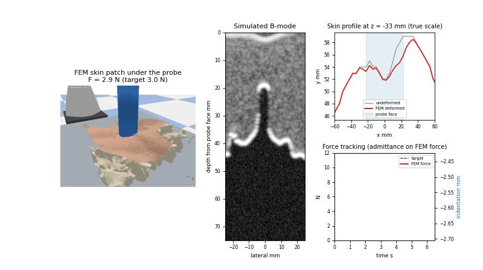

# MTP: Surgical Physics Bridge & Autonomous Robotic Ultrasound

A simulator and benchmark for robotic ultrasound reconstruction of the lumbar spine. A Franka Panda holds a
transverse probe on a CT-derived patient. A patient-specific GPU finite-element (FEM) tissue model computes the
contact force, the soft-tissue deformation and the deformed skin. The B-mode image is simulated from the deformed
CT. Bone surface points are segmented from the B-mode image alone and fused into a 3D reconstruction of L4. Six
scanning policies (two heuristics, greedy NBV, PPO, flow matching, diffusion) are compared on the same budget.
The scene can be streamed to 3D Slicer over OpenIGTLink.

This is a research prototype that runs on one patient CT. Read [Limitations](#limitations) before using any number below.



*`demonstrations/demo_fem_soft_body.gif` (also `.mp4`), generated by
`ReconstructionPipeline/scripts/record_soft_body_demonstrations.py --video` from model outputs: the robot presses
the probe on the L4 midline with a 3 → 10 → 3 N force ramp, then slides laterally. The four panels are the
PyBullet render with the FEM-deformed skin, the simulated B-mode, the transverse skin profile (undeformed vs
deformed) and the force/indentation trace.*

---

## Architecture

```
 ┌──────────────────────────── unified_server.py (main process) ─────────────────────────────┐
 │  Streaming loop (--fps, default 30 Hz)                                                     │
 │    UltrasoundReconstructionEnv.step(action)                                                │
 │      ├─ tissue model (GPU FEM, default; Kelvinlet optional) ── force F0, stiffness K_c,   │
 │      │                                                         displacement field, skin    │
 │      ├─ backward-warped CT reslice → B-mode simulation → confidence → bone segmentation   │
 │      └─ back-projection + fusion → reconstructed bone points                               │
 │    → end-effector target + tissue solution (F0, K_c, δ0, contact point, beam) ───────┐     │
 │    → OpenIGTLink (pyigtl) to 3D Slicer, port 18944                                    │     │
 └───────────────────────────────────────────────────────────────────────────────────────┼─────┘
                     PhysicsChannels (queues + lock-protected snapshots + ring buffers)  │
 ┌───────────── physics process (1 kHz, PyBullet DIRECT) ────────┐   ┌──── viewer process (--gui) ────┐
 │  IK + motor control of the Panda, stepSimulation              │   │  PyBullet GUI client, ~60 Hz    │
 │  probe force  F = F0 + K_c (δ − δ0)  every tick               │   │  mirrors joints / probe pose,   │
 │  rigid contacts (table, virtual keep-out fixtures)            │   │  renders the FEM-deformed skin  │
 └───────────────────────────────────────────────────────────────┘   └─────────────────────────────────┘
                                         │ OpenIGTLink TCP
                                         ▼
 ┌──────────────── Slicer/slicer_surgical_physics_bridge.py (inside 3D Slicer) ───────────────┐
 │  all patient nodes under one transform "PatientToRAS" = P_TO_RAS = diag(−1, −1, 1)          │
 │  B-mode in the Red view; probe pose, reconstructed bone points, in-place deformed skin      │
 └─────────────────────────────────────────────────────────────────────────────────────────────┘
```

| Component | File | Notes |
| :--- | :--- | :--- |
| Physics loop (1 kHz) | `surgical_physics_bridge/src/pybullet_backend.py` (`run_physics_loop`) | Makes every PyBullet call. Runs in its own process by default (`--physics-mode process`), so the US/streaming work cannot take its GIL. The torso is visual-only: there is no rigid probe–torso collision, and the probe force comes from the tissue model. |
| Streaming / US loop (30 Hz) | `surgical_physics_bridge/src/unified_server.py` | Steps the env, sends targets to the physics loop and publishes to Slicer. Never touches PyBullet. |
| GPU FEM tissue service | `ReconstructionPipeline/simulation/fem_tissue.py`, `tet_mesh.py` | Called synchronously by the env on the streaming side. The 1 kHz loop never waits on it. |
| Kelvinlet tissue model (alternative) | `ReconstructionPipeline/simulation/tissue_model.py`, `kelvinlet_deformation.py` | `--tissue-backend kelvinlet`. Kept for comparison. |
| Viewer (optional) | `pybullet_backend.viewer_process_main` | Separate process with its own PyBullet GUI client, so rendering cost never lands on the 1 kHz loop. |
| Slicer bridge | `Slicer/slicer_surgical_physics_bridge.py` | Python script run inside Slicer. Uses the order-preserving `surgical_physics_bridge/src/obj_io.py`. |
| Frames | `surgical_physics_bridge/src/coordinates.py` | See [Coordinate frames](#coordinate-frames). |

### Coordinate frames

- **P (patient/simulation frame, mm)** is the CT array frame. It is **LPS**: +X = patient left, +Y = posterior
  (toward the dorsal skin), +Z = superior. The resampled `ct.nii.gz` header and the `*_ras.obj` files label it
  "RAS", but their coordinates are P coordinates.
- **P → Slicer RAS**: `P_TO_RAS = diag(−1, −1, +1)` (a rotation by π about S). Slicer keeps the data in P under one
  transform node, so the flip is applied exactly once.
- **P → PyBullet (m, Z-up)**: `pb = (0.55 + x, z, 0.42 + (y − 55)) · 1e-3`. This is a permutation with det −1, and
  it matches the PyBullet meshes written by `prepare_patient_assets`. Orientations are built with
  `probe_axes_to_pybullet_quaternion`, which always returns a proper rotation.

## Soft-body pipeline

1. **Precomputed FEM** (`fem_tissue.py`). The model is a linear tetrahedral FEM of the CT soft tissue around L4
   on a 4 mm lattice. Bone cells and the deep and side faces of the ROI are fixed. Young's modulus comes from HU
   (fat vs muscle), with ν = 0.45. A one-off GPU PCG precompute gives the condensed skin-node compliance and the
   displacement response to a unit force along x, y and z at every free skin node, sampled on a regular lattice
   (fp16). It is cached in `ReconstructionPipeline/.fem_cache/` (gitignored). At run time, each probe pose solves
   frictionless contact with an active set over face samples. The overlap is measured along the beam and the
   contact forces act along it (the face normal), so a tilted probe also shears the tissue (DEC-040).
   The solve returns the reaction force and torque, the contact stiffness `K_c = dF/dδ`, a displacement field and
   the deformed skin mesh.
2. **Contact force from first contact** (`env_reconstruction.py`). Indentation δ is measured from the undeformed
   skin under the probe centre, so it can be negative. A flat transverse probe over the midline groove touches
   the paraspinal ridges first; at the benchmark midline pose, first contact is at δ = −9.0 mm (force sweep below).
   The force is an output of the tissue model.
3. **Admittance control.** An inner loop adjusts δ along the beam, in the range [first contact, max indentation],
   to track `target_force_n` (4 N). The policies output only the 4-DoF pose action `[dc1, dc2, dyaw, dpitch]`.
4. **Backward-warped B-mode.** CT and label slices are sampled at the indented probe-face pose through the
   inverse of the FEM displacement field (fixed-point iterations on the GPU). The model-based simulator then
   computes the image: dB→Np attenuation over the physical pixel spacing, interface transmission, specular
   reflection, Rayleigh speckle, a fixed TGC and log compression. The image is 200 × 150 px over 75 × 50 mm.
5. **Perception without privileged data.** The confidence map is computed from the B-mode image only.
   `segment_from_bmode` finds bright ridges followed by a distal shadow. Points are back-projected with the tracked
   (indented) probe-face pose and fused at 1.5 mm.
6. **Deformed skin to PyBullet and Slicer.** At startup the server writes the undeformed skin patch to
   `meshes/patient_fem_skin.obj`. It then streams all N deformed vertices (`DeformedSkin`, float32 `(1, N, 3)`, in
   file vertex order) whenever they change. Slicer writes them in place into a `vtkPoints` array that was bound
   once. The viewer process rebuilds the PyBullet visual mesh.
7. **1 kHz force extrapolation.** Every streaming step sends the latest tissue solution (F0, K_c, δ0, contact
   point, beam). Every physics tick measures the probe-face indentation δ from the PyBullet probe pose and applies
   `F = F0 + K_c (δ − δ0)`, clipped to `[0, TISSUE_FORCE_MAX_N]`, against the beam. It never waits on the solver.

Measured by `ReconstructionPipeline/tests/test_fem_tissue.py` (printed with `-s`, RTX 2050 laptop): a FEM solve
takes 1.50 ms, a 200 × 150 warp 0.25 ms, and peak VRAM is 261 MB (233 MB of it is the fp16 3-direction field). On
a cold cache the precompute takes 0.3 s of assembly plus 22.1 s of PCG (3 × 750 right-hand sides). The test asserts
solve < 10 ms and VRAM < 300 MB.

---

## Quickstart

All commands below were run from the repository root with `./.venv/bin/python` (Python 3.10).

```bash
# 1. Environment (single requirements file)
python3.10 -m venv .venv
./.venv/bin/pip install -r requirements.txt

# 2. Patient data. The CT volumes (*.nii.gz) are gitignored; the meshes are tracked.
#    This downloads case-0004 of the HF dataset SHPDRG/lumbar-ct-segmentation-human-sample-1 and resamples it:
./.venv/bin/python -m ReconstructionPipeline.data.prepare_patient_assets --export-totalseg data/sample_totalsegmentator_patient
#    (without arguments the module only builds a synthetic phantom as a smoke check)

# 3. Tests (103 tests; the FEM tests skip if the sample patient is missing)
./.venv/bin/python -m pytest ReconstructionPipeline/tests/ -q
```

**Benchmark.** Always pass `--patient-dir`. Without it the runner falls back to the synthetic phantom.

```bash
# Heuristics only (no checkpoints needed)
./.venv/bin/python ReconstructionPipeline/evaluation/benchmark_runner.py \
  --patient-dir data/sample_totalsegmentator_patient --num-trials 3 --heuristics-only

# Full 6-policy benchmark + soft-body section (the command behind results/benchmark_latest.md).
# Needs checkpoints/{submodular_ppo,flow_matching,diffusion_policy}.pt; a missing checkpoint is an error.
./.venv/bin/python ReconstructionPipeline/evaluation/benchmark_runner.py \
  --patient-dir data/sample_totalsegmentator_patient --num-trials 3 \
  --policies raster,orbital,nbv,ppo,cfm,diffusion --soft-body
```

Other flags are `--tissue-backend {fem,kelvinlet}`, `--soft-body-only`, `--no-kelvinlet-comparison`,
`--ppo-deterministic` and `--out-dir`. Results go to `results/benchmark_<timestamp>.json` and
`results/benchmark_latest.md`.

**Training.** Checkpoints (`*.pt`) are gitignored, so you must train before running the learned policies.

```bash
# Submodular PPO (default 50,000 steps, 72-step episodes, coverage-gain reward); --dry-run = 16 steps, no checkpoint
./.venv/bin/python ReconstructionPipeline/planning/train_submodular_ppo.py --max-minutes 30
# CFM + EDM diffusion by behaviour cloning of a randomised raster expert (15 % validation split by episode)
./.venv/bin/python ReconstructionPipeline/planning/train_diffusion_policy.py --num-demo-episodes 200
```

**Server and Slicer.**

```bash
# Headless physics-rate measurement (both loops, PyBullet DIRECT)
./.venv/bin/python surgical_physics_bridge/src/unified_server.py --benchmark-seconds 20

# Live server; --mode {orbital_l4,raster_l4,orbital,raster,nbv,diffusion,cfm,interactive}
./.venv/bin/python surgical_physics_bridge/src/unified_server.py --mode raster_l4 --fps 30 --gui
#   other flags: --port 18944 --physics-mode {process,thread} --physics-hz 1000 --tissue-backend {fem,kelvinlet} --urdf --patient-dir

# In another terminal: 3D Slicer 5.x with the bridge script
Slicer --python-script Slicer/slicer_surgical_physics_bridge.py

# Or both at once (finds Slicer in ~/Downloads/Slicer-5.12.4-linux-amd64, /opt/slicer, PATH)
bash scripts/launch_dual_pybullet_slicer.sh --mode raster_l4
```

**Demo video.** `./.venv/bin/python -m ReconstructionPipeline.scripts.record_soft_body_demonstrations --video`

**Remote GPU host.** See [`Docs/SSH_TOTAL_SEGMENTATOR_DEPLOYMENT.md`](Docs/SSH_TOTAL_SEGMENTATOR_DEPLOYMENT.md). The script refuses to run outside `*/workspace/rishang/*`.

---

## Results

The tables below are copied from [`results/benchmark_latest.md`](results/benchmark_latest.md) (run
`20261105_120357`, raw: [`results/benchmark_20261105_120357.json`](results/benchmark_20261105_120357.json)), produced
after the normal-contact change (DEC-040) with the same command and checkpoints as the 2026-11-04 run.

- **Setup.** One patient, target `vertebrae_L4`, 3 trials, FEM tissue backend, target force 4.0 N. Values are
  mean ± std over trials.
- **Budget and start poses.** Every method gets 72 frames. Trial k of every method starts from the same pose,
  drawn uniformly over the scan window (inset 4 mm), with yaw ±15° and pitch ±10°.
- **Policy execution.** PPO samples its stochastic policy. CFM and Diffusion execute 2 actions of each 8-step chunk.
- **Metrics.** Cov is the coverage of the US-visible dorsal L4 surface. Prec is the fraction of reconstructed
  points within tolerance of any bone surface in the volume. Prec vis is the same fraction measured against the
  dorsal-visible bone surface only. Force is the tissue-model reaction force under the admittance controller.

### Policies

| Method | Cov@2 % | Cov@3 % | Prec@2 % | Prec@3 % | Prec@2 vis % | F@2 | Chamfer mm | F mean N | F RMSE N | F max N | Unsafe | Indent mm | Path mm |
|---|---|---|---|---|---|---|---|---|---|---|---|---|---|
| Heuristic_Raster | 80.6 ± 0.3 | 88.1 ± 0.4 | 100.0 ± 0.0 | 100.0 ± 0.0 | 97.4 ± 0.2 | 0.89 ± 0.00 | 1.05 ± 0.01 | 3.98 ± 0.01 | 0.07 ± 0.02 | 4.1 ± 0.0 | 0 ± 0 | 0.9 ± 0.1 | 174 ± 9 |
| Heuristic_Orbital | 62.5 ± 0.1 | 70.1 ± 0.2 | 99.6 ± 0.0 | 100.0 ± 0.0 | 94.4 ± 0.1 | 0.77 ± 0.00 | 1.61 ± 0.02 | 3.97 ± 0.00 | 0.09 ± 0.00 | 4.1 ± 0.0 | 0 ± 0 | 0.6 ± 0.1 | 227 ± 2 |
| Greedy_NBV | 72.3 ± 2.2 | 83.8 ± 1.0 | 99.7 ± 0.4 | 99.9 ± 0.1 | 96.9 ± 0.5 | 0.84 ± 0.02 | 1.20 ± 0.02 | 3.98 ± 0.01 | 0.09 ± 0.04 | 4.1 ± 0.0 | 0 ± 0 | 1.5 ± 0.3 | 342 ± 7 |
| Submodular_PPO | 74.8 ± 1.5 | 85.0 ± 1.5 | 99.0 ± 0.1 | 99.9 ± 0.1 | 92.5 ± 0.2 | 0.85 ± 0.01 | 1.14 ± 0.04 | 3.93 ± 0.01 | 0.23 ± 0.04 | 4.8 ± 0.7 | 0 ± 0 | -1.2 ± 0.3 | 272 ± 13 |
| Flow_Matching_CFM | 75.5 ± 1.2 | 83.7 ± 1.4 | 99.8 ± 0.1 | 100.0 ± 0.1 | 97.6 ± 0.9 | 0.86 ± 0.01 | 1.15 ± 0.04 | 3.99 ± 0.00 | 0.04 ± 0.01 | 4.1 ± 0.0 | 0 ± 0 | 0.2 ± 0.4 | 123 ± 13 |
| Diffusion_Policy | 62.2 ± 4.8 | 71.0 ± 4.4 | 99.7 ± 0.2 | 100.0 ± 0.0 | 96.3 ± 2.0 | 0.77 ± 0.04 | 1.63 ± 0.18 | 3.99 ± 0.01 | 0.06 ± 0.03 | 4.1 ± 0.0 | 0 ± 0 | 1.3 ± 0.7 | 178 ± 19 |

### Soft-body: force sweep

From [`results/benchmark_latest.md`](results/benchmark_latest.md). Midline L4, untilted probe. The echo depth is
detected from the B-mode image.

| Backend | target_force_n | model_force_n | indentation_mm | indentation_from_first_contact_mm | echo_depth_mm | expected_echo_depth_mm | tangent_stiffness_n_per_mm | indentation_limited |
|---|---|---|---|---|---|---|---|---|
| fem | 1.00 | 1.00 | -5.04 | 3.96 | 22.24 | 21.79 | 0.46 | False |
| fem | 2.00 | 2.00 | -3.74 | 5.26 | 21.11 | 20.49 | 0.90 | False |
| fem | 4.00 | 4.00 | -1.88 | 7.12 | 19.22 | 18.63 | 1.28 | False |
| fem | 6.00 | 6.00 | -0.68 | 8.32 | 18.09 | 17.43 | 2.03 | False |
| fem | 8.00 | 8.00 | 0.20 | 9.20 | 16.96 | 16.55 | 2.49 | False |
| fem | 10.00 | 10.00 | 0.95 | 9.95 | 16.58 | 15.80 | 2.85 | False |
| kelvinlet | 1.00 | 1.00 | 1.70 | 1.70 | 15.45 | 15.05 | 0.67 | False |
| kelvinlet | 2.00 | 2.00 | 3.06 | 3.06 | 14.32 | 13.69 | 0.81 | False |
| kelvinlet | 4.00 | 4.00 | 5.15 | 5.15 | 12.06 | 11.60 | 1.11 | False |
| kelvinlet | 6.00 | 6.00 | 6.75 | 6.75 | 10.55 | 10.00 | 1.41 | False |
| kelvinlet | 8.00 | 8.00 | 8.04 | 8.04 | 9.42 | 8.71 | 1.70 | False |
| kelvinlet | 10.00 | 8.82 | 8.50 | 8.50 | 8.67 | 8.25 | 1.83 | True |

### Soft-body: stiffness sweep

From [`results/benchmark_latest.md`](results/benchmark_latest.md). Raster, first 40 poses. The model is
re-calibrated to k0 for each row.

| Backend | k0 | modulus_kpa | mean_indentation_mm | mean_force_n | force_rmse_n | max_force_n | coverage3_pct |
|---|---|---|---|---|---|---|---|
| fem | k0_0.3 | 10.24 | 2.65 | 3.99 | 0.08 | 4.16 | 77.35 |
| fem | k0_0.5 | 21.92 | 0.76 | 3.99 | 0.03 | 4.04 | 76.81 |
| fem | k0_0.8 | 46.45 | -0.61 | 3.99 | 0.22 | 4.97 | 76.63 |
| kelvinlet | k0_0.3 | 2.02 | 8.03 | 3.99 | 0.11 | 4.32 | 76.63 |
| kelvinlet | k0_0.5 | 3.37 | 5.83 | 3.99 | 0.08 | 4.21 | 77.35 |
| kelvinlet | k0_0.8 | 5.39 | 4.18 | 4.00 | 0.04 | 4.10 | 76.45 |

### Soft-body: rigid vs deformation-aware vs deformation-unaware

From [`results/benchmark_latest.md`](results/benchmark_latest.md). Same anatomy, raster trajectory and seeds.

| Backend / mode | Cov@2 % | Cov@3 % | Prec@2 % | Prec@3 % | Prec@2 vis % | F@2 | Chamfer mm | F mean N | F RMSE N | F max N | Unsafe | Indent mm | Path mm |
|---|---|---|---|---|---|---|---|---|---|---|---|---|---|
| fem / rigid | 81.7 ± 0.2 | 89.0 ± 0.1 | 99.9 ± 0.0 | 100.0 ± 0.0 | 97.3 ± 0.1 | 0.90 ± 0.00 | 1.04 ± 0.00 | 3.98 ± 0.00 | 0.07 ± 0.01 | 4.1 ± 0.0 | 0 ± 0 | 0.9 ± 0.0 | 164 ± 1 |
| fem / aware | 80.6 ± 0.3 | 88.0 ± 0.2 | 99.9 ± 0.1 | 100.0 ± 0.0 | 97.2 ± 0.1 | 0.89 ± 0.00 | 1.05 ± 0.01 | 3.98 ± 0.00 | 0.07 ± 0.01 | 4.1 ± 0.0 | 0 ± 0 | 0.9 ± 0.0 | 164 ± 1 |
| fem / unaware | 77.1 ± 0.2 | 88.8 ± 0.4 | 84.6 ± 0.2 | 99.7 ± 0.0 | 81.5 ± 0.2 | 0.81 ± 0.00 | 1.49 ± 0.00 | 3.98 ± 0.00 | 0.07 ± 0.01 | 4.1 ± 0.0 | 0 ± 0 | 0.9 ± 0.0 | 164 ± 1 |
| kelvinlet / rigid | 81.7 ± 0.2 | 89.0 ± 0.1 | 99.9 ± 0.0 | 100.0 ± 0.0 | 97.3 ± 0.1 | 0.90 ± 0.00 | 1.04 ± 0.00 | 3.98 ± 0.00 | 0.08 ± 0.00 | 4.2 ± 0.0 | 0 ± 0 | 5.9 ± 0.0 | 164 ± 1 |
| kelvinlet / aware | 81.1 ± 0.3 | 89.0 ± 0.4 | 99.0 ± 0.0 | 100.0 ± 0.0 | 89.3 ± 0.2 | 0.89 ± 0.00 | 1.06 ± 0.00 | 3.98 ± 0.00 | 0.08 ± 0.00 | 4.2 ± 0.0 | 0 ± 0 | 5.9 ± 0.0 | 164 ± 1 |
| kelvinlet / unaware | 7.6 ± 0.3 | 23.1 ± 0.5 | 19.9 ± 0.1 | 44.2 ± 0.2 | 14.9 ± 0.1 | 0.11 ± 0.00 | 3.80 ± 0.01 | 3.98 ± 0.00 | 0.08 ± 0.00 | 4.2 ± 0.0 | 0 ± 0 | 5.9 ± 0.0 | 164 ± 1 |

### Physics rate

Command: `unified_server.py --benchmark-seconds 20`, RTX 2050 laptop, FEM backend, physics in its own process.
Rows from [`results/physics_rate_20261104_idle.json`](results/physics_rate_20261104_idle.json) (idle, load avg 1.7)
and [`results/physics_rate_20261105_normal_contact.json`](results/physics_rate_20261105_normal_contact.json) (after
DEC-040, run right after the benchmark, load avg 3.3).

| Run | Achieved | Period p50 | Period p99 | Period max | Tick compute p99 | Overruns / ticks | Resyncs | Streaming loop |
|---|---|---|---|---|---|---|---|---|
| 2026-11-04 | 1000.0 Hz | 1.000 ms | 1.137 ms | 4.21 ms | 0.455 ms | 2 / 20040 | 0 | 29.95 Hz |
| 2026-11-05 (normal contact) | 1000.0 Hz | 1.000 ms | 1.000 ms | 3.75 ms | 0.312 ms | 17 / 20015 | 0 | 29.9 Hz |

---

## Limitations

- **The simulator is too easy for perception.** Reconstruction precision against the dorsal-visible surface is
  92–97 % for every policy, and Prec@2 against the whole bone volume is 99–100 %. Published B-mode bone
  segmentation on real spine ultrasound reaches about 0.8–0.9 precision within 1–2 mm (e.g. Baka et al. 2017:
  recall 0.86, precision 0.82). The simulated images lack the clutter, reverberation and soft-tissue echoes that
  cause false positives in practice, so the precision numbers here are optimistic.
- **One patient and 3 trials.** All training and testing use the same CT (`case-0004`, L4). There is no held-out
  anatomy, so the learned policies are not shown to generalise to other patients. With 3 trials, differences of a
  few percent (e.g. PPO 85.0 vs NBV 83.8 vs CFM 83.7 Cov@3) are within noise.
- **No learned policy beats the raster.** The elevational raster has the best Cov@3 (88.1 %). Sampled PPO reaches
  85.0 %, CFM 83.7 % and Diffusion 71.0 %. CFM and Diffusion clone a randomised raster expert, so the expert caps
  them. The cloned policies are sensitive to small physics changes: the normal-contact fix (DEC-040), which
  leaves the raster at 88.1 %, moved CFM from 78.4 ± 5.7 to 83.7 ± 1.4 % without retraining (the benchmark is
  deterministic, so this is the physics change, not run-to-run noise; see DEC-040).
- **PPO only works stochastically.** With its mean action (`--ppo-deterministic`), PPO drops to 52.6 ± 5.8 % Cov@3
  and a 60 mm path. Source: [`results/ppo_deterministic/benchmark_latest.md`](results/ppo_deterministic/benchmark_latest.md),
  from the same seeds and start poses as the main table. Sampled PPO also has the worst force tracking (RMSE 0.23 N,
  max 4.8 N), and its mean indentation is −1.2 mm.
- **The FEM is linear and frictionless.** It assumes small strain on the reference geometry. Strain stiffening
  (exponential law) is a per-node correction applied to the force only, not to the displacement field. Contact
  acts along the probe-face normal (DEC-040), but there is no tangential (friction) force, so a sliding probe
  does not drag the skin. The skin points under the face are found on the undeformed surface. Outside the L4 ROI
  the displacement is zero. The PPO, CFM and Diffusion checkpoints were trained before DEC-040 and were not
  retrained.
- **Force safety is not demonstrated.** "Unsafe" counts frames above 20 N. Under 4 N admittance control no policy
  comes close, so the column is 0 by construction of the controller, not because a policy learned to be safe.
- **The Slicer bridge has no automated test inside Slicer.** `slicer_surgical_physics_bridge.py` was checked by
  hand in Slicer 5.12.4 on 2026-11-05 (DEC-039), but no automated test runs it inside 3D Slicer. The server-side
  message packing is covered by `test_server.py`.
- **The deformation-unaware penalty is small with the FEM.** At 4 N on this patient the FEM indentation is
  0.9 mm, because the probe first touches the paraspinal ridges. Ignoring the deformation therefore costs FEM
  mainly visible precision (97.2 → 81.5 % Prec@2 vis) and Chamfer distance (1.05 → 1.49 mm), and almost no Cov@3.
  The dramatic drop (89.0 → 23.1 % Cov@3) appears only with the softer Kelvinlet model (5.9 mm indentation). The
  claim that "deformation awareness matters" therefore depends on tissue stiffness and thickness.
- **Other gaps.** The B-mode simulation budget (< 2 ms) is a design target that no test asserts. The server's
  `diffusion` / `cfm` live modes load the checkpoints but are not covered by tests. `CMD`/`VirtualFixture` messages
  are handled by the server, but the Slicer bridge does not send them.

---

## Repository structure

```text
MTP/
├── README.md, FLOW.md, DECISIONS.md, QUIZME.md, AGENTS.md
├── requirements.txt                    # single dependency list (setup.py reads it)
├── setup.py
├── data/sample_totalsegmentator_patient/
│   ├── ct.nii.gz, segmentations/*.nii.gz   # gitignored, created by prepare_patient_assets --export-totalseg
│   └── meshes/                         # spine / L4 / torso OBJ (tracked); patient_fem_skin.obj written by the server
├── demonstrations/demo_fem_soft_body.{gif,mp4}
├── results/                            # benchmark_*.json, benchmark_latest.md, physics_rate_*.json, ppo_deterministic/
├── checkpoints/                        # *.pt gitignored
├── scripts/
│   ├── launch_dual_pybullet_slicer.sh  # server (--gui) + Slicer
│   └── run_remote_totalsegmentator.sh  # remote setup / prepare / train / benchmark
├── surgical_physics_bridge/src/
│   ├── unified_server.py               # streaming loop, OpenIGTLink, process orchestration
│   ├── pybullet_backend.py             # 1 kHz physics loop, viewer process, PhysicsChannels
│   ├── physics_rate.py                 # PhysicsRateMonitor (lock-free ring buffers)
│   ├── coordinates.py                  # P (LPS) <-> RAS <-> PyBullet
│   └── obj_io.py                       # order-preserving OBJ reader/writer
├── Slicer/slicer_surgical_physics_bridge.py   # runs inside 3D Slicer (+ reference PDFs)
├── ReconstructionPipeline/
│   ├── data/prepare_patient_assets.py  # TotalSegmentator loader, skin height map, mesh export
│   ├── simulation/
│   │   ├── fem_tissue.py, tet_mesh.py  # GPU FEM tissue model (default)
│   │   ├── tissue_model.py             # TissueModel contract + Kelvinlet backend
│   │   ├── kelvinlet_deformation.py    # regularised Kelvinlet kernel (de Goes & James 2017)
│   │   ├── slice_extractor.py          # grid_sample reslicing
│   │   ├── ultrasound_model_based.py   # B-mode simulator
│   │   └── confidence_map.py           # image-only confidence
│   ├── reconstruction/                 # bone_segmentation.py, point_cloud_accumulator.py, metrics.py
│   ├── registration/icp_registration.py
│   ├── planning/                       # env_reconstruction.py, heuristic_planner.py, start_pose.py,
│   │                                   # pointnet_encoder.py, train_submodular_ppo.py,
│   │                                   # train_diffusion_policy.py, diffusion_policy.py, flow_matching_policy.py
│   ├── evaluation/benchmark_runner.py
│   ├── scripts/record_soft_body_demonstrations.py
│   └── tests/                          # 12 test modules
├── Docs/                               # design notes, remote deployment guide, presentation sources (historical)
├── LiteratureSurvey/, Notes/
└── .agents/                            # local agent scratch, gitignored
```

## Project files

- [`DECISIONS.md`](DECISIONS.md): decision log (DEC-037 audit, DEC-038 integration and retraining).
- [`FLOW.md`](FLOW.md): execution flows, data routes, frames and verification recipes.
- [`QUIZME.md`](QUIZME.md): pre-implementation questions for major changes.
- [`AGENTS.md`](AGENTS.md): instructions and invariants for coding agents.
